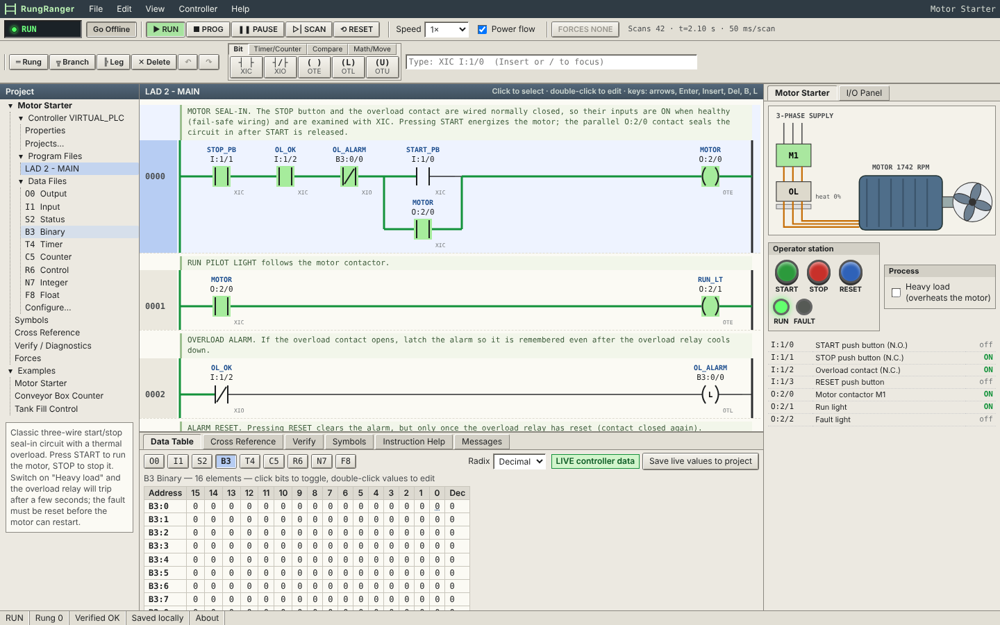
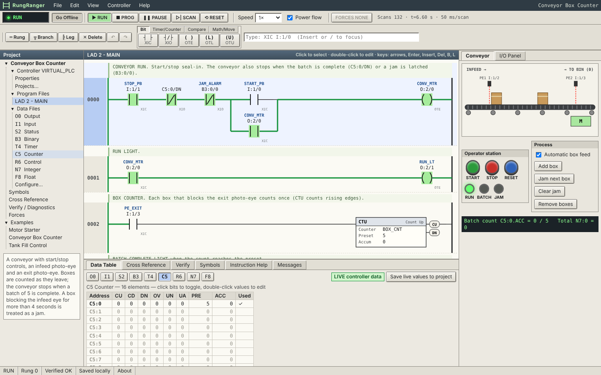
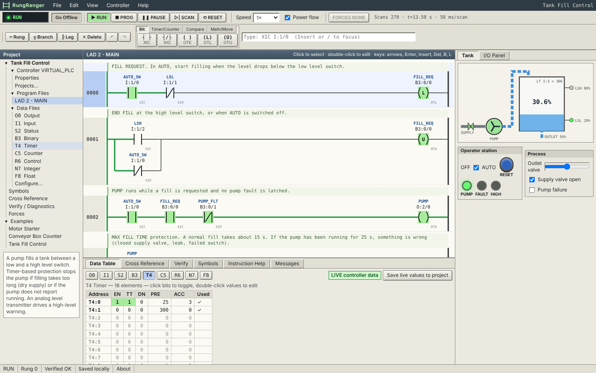
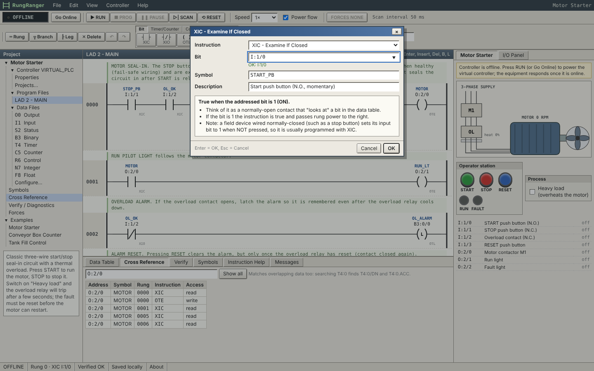

# RungRanger

**A free, open-source ladder logic editor and PLC simulator that runs in your web browser.**

RungRanger is for people who learned on (or want to learn) classic ladder logic: retired controls engineers, technicians, students and hobbyists. Open the page and you can build a program, run it against animated virtual equipment, troubleshoot it and save it. You don't need a license, PLC hardware, an install or an account.



| Conveyor with box counter | Tank fill control |
| --- | --- |
|  |  |



## What it does

- **Ladder editor (SVG):** left and right power rails, series and nested parallel branches, and outputs right-justified on the rung. You can insert, delete, move, cut, copy and paste instructions and rungs, with undo and redo. Rungs have comments, and a symbol and description can be shown above each address.
- **Mnemonic text entry:** type `XIC I:1/0 BST XIC O:2/0 NXB XIC B3:0/0 BND OTE O:2/0` to insert instructions, or edit a whole rung as text.
- **Keyboard driven:** use the arrows, Enter, Insert, Delete, B (branch), L (leg), Ctrl+Z/Y, F5 (run), F6 (program) and F7 (single scan). See *Help > Keyboard shortcuts*.
- **Deterministic virtual PLC:** each scan does an input scan, then sequential rung evaluation with branch logic, then an output scan. Simulated time advances by exactly one scan interval per scan, so a given program and input sequence always produce the same result.
- **Controller modes:** Online/offline (download), RUN, PROGRAM, PAUSE, single scan, reset, and simulated major faults with Clear Fault.
- **Live monitoring:** true instructions are highlighted green and power-flow wires are colored. Timer, counter and compare boxes show their live values, and timer and counter status bits are shown too.
- **Data table viewer:** shows the O0, I1, S2, B3, T4, C5, R6, N7 and F8 files plus any files you add. You can view in decimal, hex or binary, toggle bits with a click and edit values by double-clicking. You can configure file sizes and add data files 9 to 255.
- **Forces:** you can force I/O bits on or off from the data table or the I/O panel, with a global enable/disable and a visible FORCES indicator.
- **Cross reference:** search by address or symbol. It also finds overlapping data, so searching `T4:0` finds `T4:0/DN` and `T4:0.ACC`.
- **Verify:** live program validation with errors and warnings. Click a message to jump to the rung. A program with errors can't be downloaded.
- **Virtual equipment:** an animated motor starter, conveyor and tank that respond to the outputs and drive the inputs. A generic 16-in/16-out I/O panel with an analog input is available for any project.
- **Projects:** autosave to browser storage (IndexedDB), with multiple projects, rename, duplicate, delete and JSON import/export. Imports are validated, damaged files are recovered where possible, and the schema is versioned.
- **Works offline** once loaded (a service worker caches the app). There is no backend.

## Quick start (no install)

Open the deployed site, for example `https://<your-github-user>.github.io/rungranger/`. The Motor Starter example opens on first visit. Then:

1. Press **▶ RUN**. This downloads the program to the virtual controller and starts scanning.
2. Press and hold **START** on the operator station on the right. The motor spins and rung 0 lights up.
3. Press **STOP**, or tick **Heavy load** and watch the overload trip, latch the alarm and flash the fault light.
4. Double-click any instruction to change its address, or pick a new instruction from the toolbar palette.

Your work is saved automatically in this browser.

> ⚠️ **Back up your work.** Browser storage can be cleared by you, by privacy tools, or by the browser itself when disk space is low. Use **File > Export project (JSON)** to keep a copy of anything important.

## Installation and local development

You need Node.js 20 or newer (22 recommended).

```bash
git clone https://github.com/<you>/rungranger.git
cd rungranger
npm install
npm run dev          # http://localhost:5173
```

| Command | What it does |
| --- | --- |
| `npm run dev` | Vite dev server with hot reload |
| `npm test` | Vitest unit tests (engine, instructions, addressing, persistence, examples) |
| `npm run typecheck` | TypeScript type check |
| `npm run build` | Production build into `dist/` |
| `npm run preview` | Serve the production build locally |
| `npm run test:e2e` | Playwright end-to-end tests (builds and serves the app automatically) |
| `npm run screenshots` | Regenerate the README screenshots in `docs/screenshots/` |

For Playwright, run `npx playwright install chromium` once if you don't already have a Chromium build for Playwright.

## Deploying to GitHub Pages

The workflow in `.github/workflows/deploy.yml` type-checks the code, runs the unit and end-to-end tests, builds the site and deploys it to GitHub Pages on every push to `main`.

1. Push the repository to GitHub.
2. In **Settings > Pages**, set **Source** to **GitHub Actions**.
3. Push to `main`, or run the workflow manually from the **Actions** tab.

The Vite `base` is set to `'./'`, so all asset URLs are relative. The same build works at `https://user.github.io/rungranger/`, on a custom domain, or from any sub-folder, so you don't need to change the base path.

## Addressing

RungRanger uses classic file-based PLC addressing.

| File | Type | Example addresses |
| --- | --- | --- |
| O0 | Output image | `O:2/0`, `O:2` (word) |
| I1 | Input image | `I:1/0`, `I:1.0/0`, `I:3` (analog word) |
| S2 | Status (partial) | `S:1/15` first pass, `S:4` clock, `S:5/0` overflow trap |
| B3 | Binary | `B3:0/5`, `B3/21` (flat bit = `B3:1/5`) |
| T4 | Timer | `T4:0`, `T4:0.PRE`, `T4:0.ACC`, `T4:0/EN`, `/TT`, `/DN` |
| C5 | Counter | `C5:0`, `.PRE`, `.ACC`, `/CU`, `/CD`, `/DN`, `/OV`, `/UN`, `/UA` |
| R6 | Control | `R6:0`, `.LEN`, `.POS`, `/EN`, `/DN`, `/ER` … |
| N7 | Integer (16-bit signed) | `N7:0`, `N7:0/3` |
| F8 | Floating point | `F8:0` |

Simulated I/O hardware: each I/O "slot" is one 16-bit word. By convention the examples and I/O panel use slot 1 as a 16-point input card (`I:1/x`), slot 2 as a 16-point output card (`O:2/x`) and slot 3 as an analog input (`I:3`, 0 to 1000). You can change the file sizes under **Controller > Data Files**. Symbols (for example `START_PB`) can be typed anywhere an address is expected.

Simulated status file bits: `S:0/0` carry, `S:0/1` overflow, `S:0/2` zero, `S:0/3` sign, `S:1/15` first pass, `S:4` free-running clock (10 ms per count), `S:5/0` overflow trap and `S:6` major fault code. No other status words are simulated.

## Supported instructions

All 18 instructions are actually executed by the simulator. Each one has unit tests in `src/runtime/instructions.test.ts`.

| Category | Instructions |
| --- | --- |
| Bit | `XIC` examine if closed, `XIO` examine if open, `OTE` output energize, `OTL` latch, `OTU` unlatch |
| Timer/Counter | `TON` on-delay, `TOF` off-delay, `RTO` retentive on-delay, `CTU` count up, `CTD` count down, `RES` reset |
| Compare | `EQU`, `NEQ`, `LES`, `GRT` |
| Math/Move | `MOV`, `ADD`, `SUB` |

Behaviour summary (also shown in **Help > Instruction reference**):

- **TON, TOF and RTO:** time bases are 1.0 s and 0.01 s. Time accumulates between consecutive executions of an enabled timer, and sub-tick remainders carry over. The accumulator stops at the preset. A negative preset or accumulator causes major fault 0034h.
- **CTU and CTD:** count on false-to-true transitions using the CU/CD bits. Counting wraps at ±32767/-32768 and sets OV or UN. DN means ACC ≥ PRE.
- **ADD, SUB and MOV:** integer results that overflow are clamped to 32767 or -32768 and set `S:0/1` and the overflow trap `S:5/0`. If `S:5/0` is still set at the end of the scan, the controller major-faults with code 0020h. Clear it with `OTU S:5/0` if you expect overflow. Floats are converted to integers by rounding half to even.
- Every instruction executes every scan with its rung-condition-in, so an `OTE` on a false rung clears its bit, a `TON` on a false rung resets, and so on.

## Examples

| Example | Teaches |
| --- | --- |
| **Motor Starter** | Three-wire start/stop seal-in, normally-closed fail-safe wiring, overload latch and reset (OTL/OTU), a flashing light from the `S:4` clock, a start counter (CTU) and run time (RTO) |
| **Conveyor Box Counter** | Photo-eyes, CTU batch counting with RES, TON jam detection, a manual one-shot with ADD, and first-scan `S:1/15` initialization |
| **Tank Fill Control** | Level-switch fill control with latch/unlatch, timer-based protection (maximum fill time and pump feedback), and an analog input with MOV, GRT, LES and SUB |

Each example has fault buttons on its equipment panel (heavy load, jam, closed supply valve, pump failure) so you can practise troubleshooting.

## Architecture

```
src/
  core/          Ladder AST, addressing, instruction metadata, validation, cross reference,
                 mnemonic text parser (pure TypeScript, no DOM)
  runtime/       Data table memory, compiler (AST -> closures), deterministic scan engine,
                 equipment/PLC coupling
  equipment/     Physics models for the virtual motor starter, conveyor and tank
  persistence/   Storage adapter interface, IndexedDB + in-memory stores, schema
                 versioning, import validation and recovery
  examples/      The three example projects (written in mnemonic text)
  store/         Zustand app state (editing, undo/redo, autosave) and the virtual controller
                 scheduler
  ui/            React components: menus, toolbars, SVG ladder, panels, dialogs, equipment
```

The engine never touches the DOM and doesn't depend on React, so it is fully unit-tested in Node. The UI paces scans to real time with `requestAnimationFrame`, but each scan advances simulated time by a fixed interval. Wall-clock jitter changes how many scans run per frame, never what a scan computes.

`ProjectStore` in `src/persistence/adapter.ts` is the storage interface. IndexedDB is the only implementation today. A GitHub-backed or file-system-backed store can be added without touching the editor or the engine. The file includes a sketch of a GitHub adapter.

## Optional AI assistance (documentation only)

RungRanger contains no AI integration, and none is needed. [docs/AI.md](docs/AI.md) is a guide for anyone who wants to add an optional Claude-powered tutor later. It covers rung explanations, instruction tutoring, troubleshooting and proposed edits, and includes a suggested TypeScript contract, a server-side proxy example, how to turn proposals into safe, validated and undoable edits, and the security rules. In short, a public static site must never contain a shared API key.

## Known limitations

- **Not an emulator.** Instruction semantics follow general, publicly documented ladder logic behaviour, written independently. They have **not** been verified against real PLC hardware. Edge cases may differ: timer accuracy and accumulator behaviour beyond the preset, counter DN after an overflow, carry flags, status file contents, and first-scan and power-up behaviour. Do not use RungRanger to validate programs for real machinery.
- There is one program file (LAD 2). There are no subroutines (JSR/SBR/RET), one-shots (ONS/OSR), file instructions, shift registers, sequencers, PID or communications.
- Only part of the status file is simulated. Real I/O configuration, module types and the processor model are not modelled. I/O is a simple word-per-slot image.
- Edits made while online apply immediately at the next scan if the program verifies. If it doesn't, the controller keeps running the last good program. There is no test/assemble/accept edit workflow.
- Going offline powers down the simulated controller. Data values are retained only while online, unless you use **Save live values to project**.
- Undo history isn't saved between sessions. Browser storage may be cleared by the browser, so export backups.
- The layout is designed for desktop screens. It works on tablets, but on phones it's cramped.
- Forces apply only to I/O bits.
- Scans are paced by browser animation frames. When the browser tab is hidden, the simulation pauses. A very short scan interval with a high speed setting is capped at 200 scans per frame.

## Roadmap

- One-shot instructions (ONS, OSR, OSF), JSR/SBR/RET subroutines and multiple program files
- More math and data instructions (MUL, DIV, CPT, LIM, MEQ, COP, FLL, BSL/BSR, SQO)
- Online edit workflow with assemble/test/accept, and compare offline vs. online
- Trend chart of selected addresses, and a scan-time and timing diagram view
- Printable program report (rungs, comments, symbols and cross reference)
- More equipment scenes (traffic light, batch mixer, garage door) and guided lessons
- Optional storage adapters (GitHub repository, local folder via the File System Access API)
- Optional AI tutor following the design in `docs/AI.md`

## Contributing

Issues and pull requests are welcome. Please keep the engine free of DOM and React dependencies, add unit tests for any instruction behaviour you change, and contribute only original code and assets.

## Security

RungRanger is a static site with no server, accounts or network calls, so its attack surface is small. These protections are in place:

- **Untrusted project files.** JSON imports and every project read back from browser storage go through `importProject` (`src/persistence/schema.ts`), which never throws. It bounds file size (10 MB), branch nesting (16 levels), rung, instruction and symbol counts, and string lengths, and it drops prototype-polluting keys. Regression tests are in `src/persistence/security.test.ts`.
- **No HTML injection sinks.** All user text (names, comments, symbols) is rendered through React, which escapes it. The code never uses `innerHTML` or `eval`.
- **Content-Security-Policy.** Production builds include a strict CSP `<meta>` tag: scripts, styles and connections are limited to the site's own origin, and there are no inline scripts or plugins. The end-to-end tests fail on any CSP violation.
- **CI.** The workflow runs with read-only permissions. Deployment permissions apply only to `main`, and pull requests can't deploy.

Known residual risks:

- **Shared origin on GitHub Pages.** All project sites under `https://<user>.github.io/` share one browser origin. Another site you publish there could read or change RungRanger's saved projects, although anything it writes is still validated on load. Serve RungRanger from its own custom domain or subdomain if that matters to you.
- GitHub Pages can't send response headers, so `frame-ancestors` (clickjacking protection) and other header-only protections aren't available. RungRanger has no sensitive actions to hijack.
- The workflow references GitHub's first-party actions by version tag. Pin them to commit SHAs for stricter supply-chain control.

Please report security issues privately via GitHub's *Report a vulnerability* (security advisories) on this repository.

## Legal and licensing

- RungRanger is released under the [MIT License](LICENSE).
- The interface, artwork, help text and example programs are original. Ladder logic concepts, instruction mnemonics and file-based addressing are standard industry terms, used descriptively for education.
- It has no license activation, license bypass, or proprietary hardware or network communication.
- **Runtime dependencies** (bundled into the site): React and React DOM (MIT), scheduler (MIT) and Zustand (MIT).
- **Development-only dependencies** (not shipped): Vite, Vitest and @vitejs/plugin-react (MIT); TypeScript, Playwright and fake-indexeddb (Apache-2.0); and lightningcss (MPL-2.0, used by Vite at build time only). None of them puts license obligations on the deployed site beyond the MIT notices of the bundled runtime libraries.
- Fonts are the system fonts already on the user's computer. No web fonts are downloaded.
